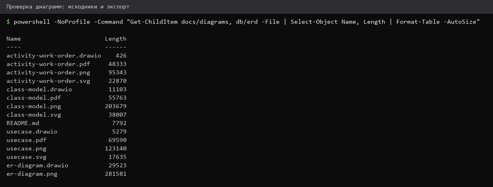
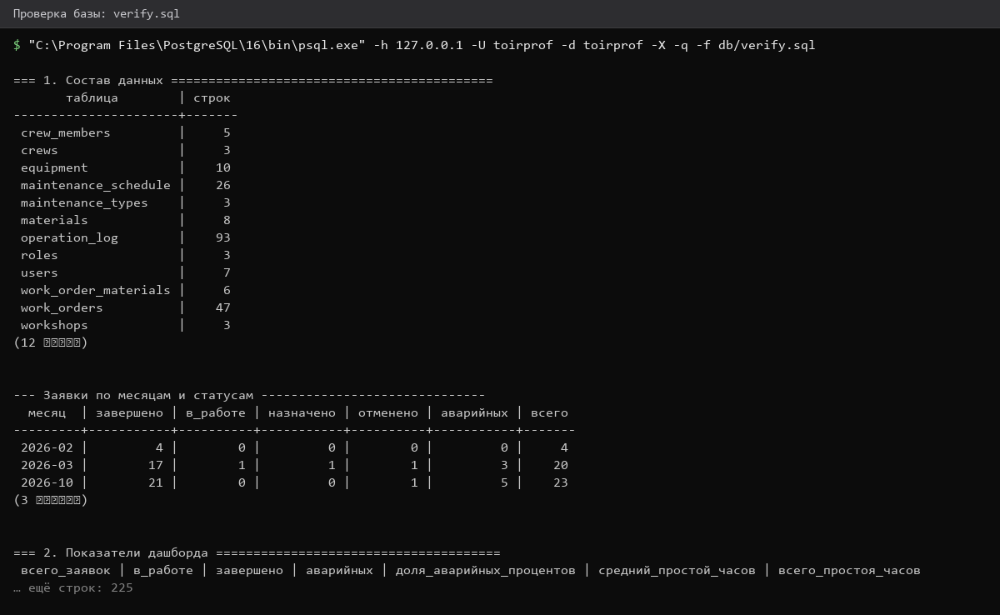
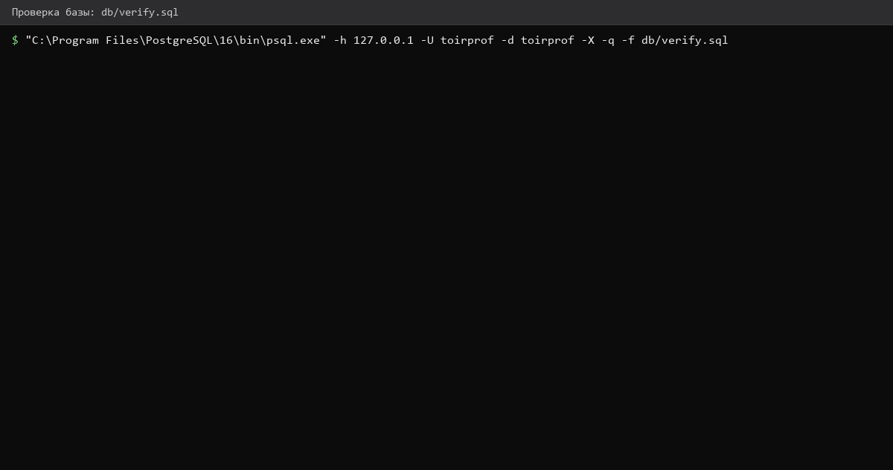
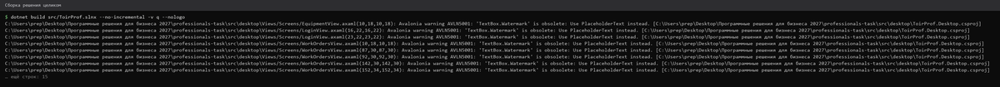
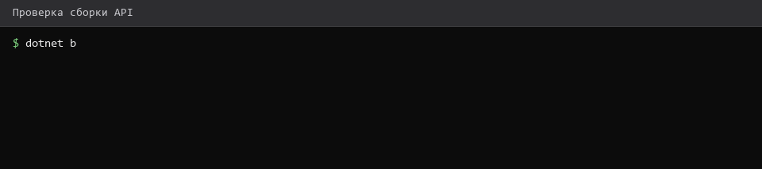
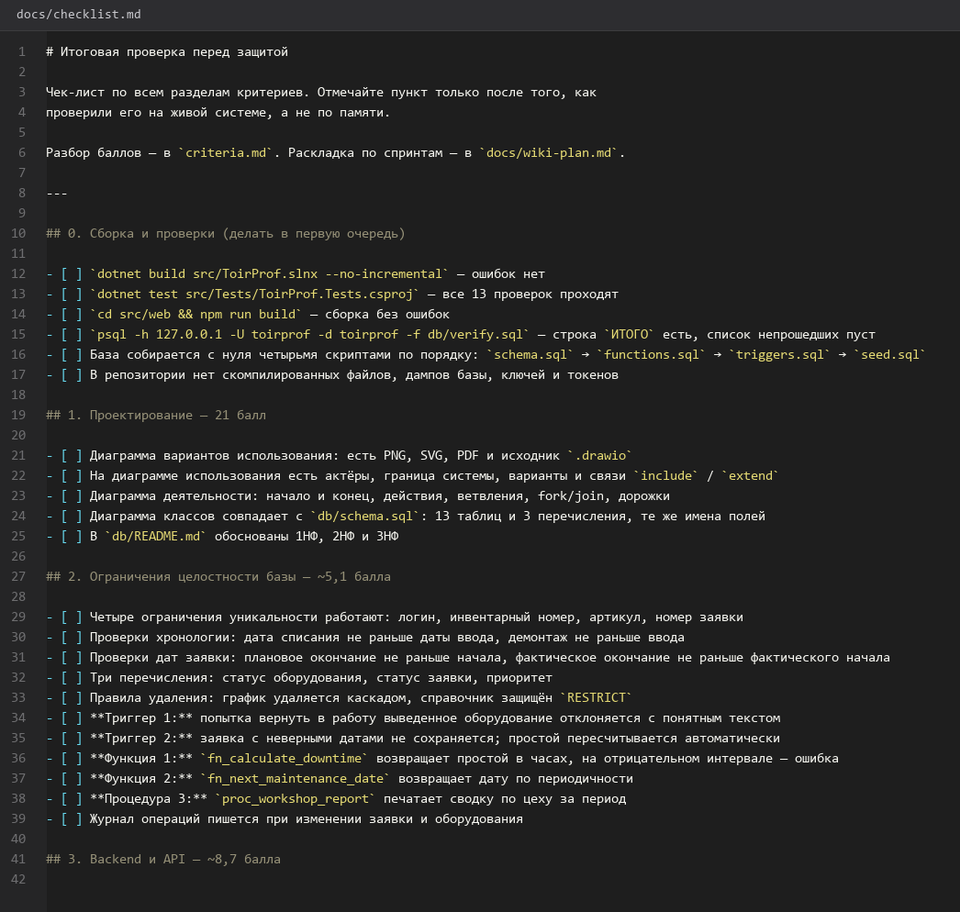
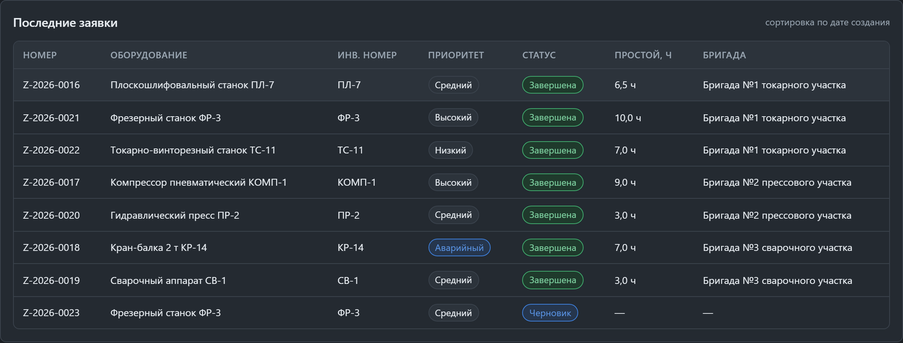
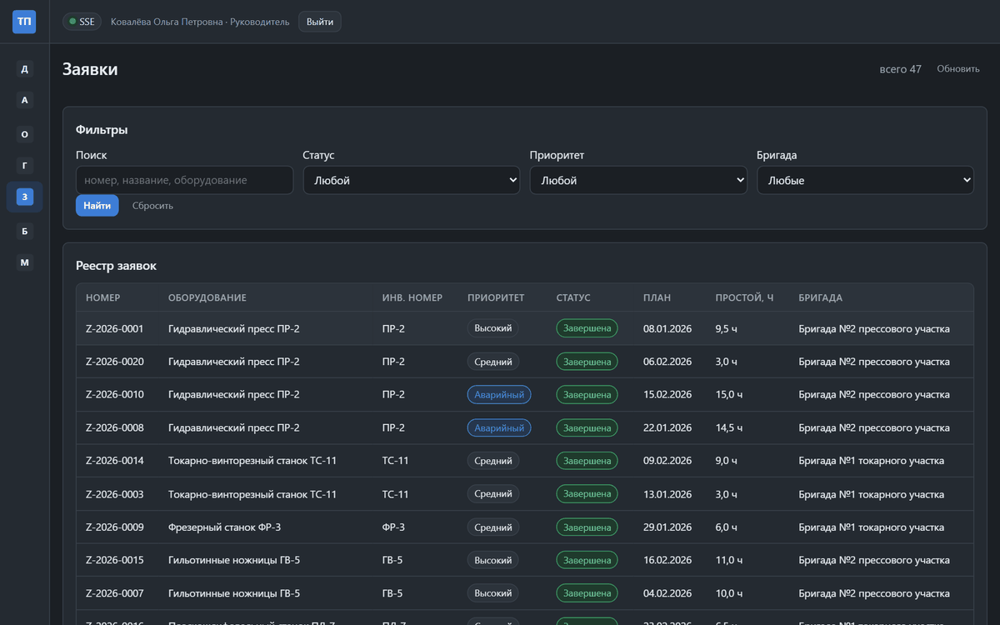

# 54. Итоговая проверка по критериям

> Спринт 24. Итоговая проверка по критериям · 145 мин · страница 54 из 54

Финальный чек-лист перед защитой: пройти по всем критериям листа оценивания и убедиться, что каждый пункт закрыт и может быть показан. Страница короткая — она нужна как список дел, а не как учебник.

**Итог страницы.** Каждый критерий из листа оценивания отмечен, непроверенных пунктов нет, система запускается одной командой.

| Критерий оценивания | Что закрывает страница |
|---|---|
| Г / Итог | Проверка по критериям перед защитой |

**Результат в репозитории:**

- `docs/criteria-checklist.md`
- `criteria.md`

## Шаг 1. Проектирование — 25 мин

Три диаграммы на месте, в нужных форматах, с исходниками и обоснованием. Модель данных соответствует диаграмме классов.

**Терминал**

```bash
```bash
# Диаграммы: исходник, PNG, SVG и README с обоснованием
ls -1 docs/diagrams/usecase/ docs/diagrams/activity/ docs/diagrams/class/
# В каждой папке: исходник (.puml), .png, .svg и README.md
```
```

> **Замечание.** Проверьте, что диаграмма классов совпадает с реальной схемой базы. Эксперт сравнивает их и первым же находит расхождение в именах полей.


*Три папки диаграмм, в каждой исходник, PNG, SVG и README*


## Шаг 2. База данных — 30 мин

Все ограничения, триггеры, функции и процедура создаются скриптами с чистой базы. Проверяем не только наличие, но и то, что они срабатывают.

**Терминал**

```bash
```bash
# Ограничения: UNIQUE, CHECK, ENUM, ON DELETE
psql -h 127.0.0.1 -U toirprof -d toirprof -c "\\d+ equipment"
# Объекты БД
psql -h 127.0.0.1 -U toirprof -d toirprof -c "\\df+ fn_* proc_*"
```
```

> **Замечание.** Проверьте ограничения на чистой базе: скрипты должны проходить подряд, без ручных правок. Если что-то требует поправить вручную — на площадке это тоже придётся.


*Ограничения и объекты БД на месте*


*Ограничения и объекты БД на месте*


## Шаг 3. API и клиенты — 35 мин

Swagger открывается, все роли работают, оба клиента запускаются и показывают данные. Проверяем с чистого запуска.

**Терминал**

```bash
```bash
dotnet test src/Tests/ToirProf.Tests.csproj
dotnet build src/api/ToirProf.Api.csproj -c Release
cd src/web && npm run build
```
```

> **Замечание.** Проверяйте сборку в Release, а не Debug. На площадке запускается собранное приложение, и ошибки оптимизации там проявляются иначе.


*Сборка без ошибок, все 5 юнит-тестов проходят*


*Сборка без ошибок, все 5 юнит-тестов проходят*


## Шаг 4. Документация и защита — 30 мин

Swagger, инструкция, руководство, презентация, текст выступления — всё в репозитории, всё открывается и читается.

**Терминал**

```bash
```bash
ls -1 docs/ docs/presentation/ postman/
# Проверка, что все файлы инструкций на месте и не пустые
find docs -name '*.md' -size -1k
# (пустой вывод означает: файлов меньше килобайта нет)
```
```

> **Замечание.** Проверьте и то, что инструкция работает на чистой машине. Пять минут на проверку на второй машине экономят сорок минут на защите.


*Все документы на месте и не пустые*


## Шаг 5. Прогон всей системы и запись демонстрации — 25 мин

Финальный прогон: база, API, оба клиента, сквозной сценарий заявки. Записываем видео демонстрации как запасной вариант.

**Терминал**

```bash
```bash
# Сквозной сценарий: создать заявку → назначить бригаду → завершить со списанием
curl -s -X POST http://localhost:5080/api/work-orders \
  -H "Authorization: Bearer $TOKEN" -H 'Content-Type: application/json' \
  -d '{"equipmentId":"44444444-4444-4444-4444-444444444444","description":"Стучит подшипник","priority":"Высокий"}'
```
```

> **Замечание.** Запись демонстрации — не формальность. Если на площадке что-то не запустится, видео покажет систему лучше, чем объяснение.


*Сквозной сценарий от заявки до закрытого отчёта*


*Сквозной сценарий от заявки до закрытого отчёта*


## Если что-то не получилось

| Симптом | Что делать |
|---|---|
| Пропущен критерий без пометки | пройдите лист оценивания заново по пунктам |
| Инструкция не работает на чистой машине | проверьте на второй машине заранее |
| Диаграммы расходятся с базой | сверьте имена полей по `db/schema.sql` |
| На защите что-то не запускается | держите запись демонстрации |

## Проверка

```bash
git status --short && dotnet test src/Tests/ToirProf.Tests.csproj
```

## Коммит

```bash
git add -A
git commit -m "docs: итоговый чек-лист проверки по критериям оценивания"
```

---

[Устное выступление и ответы экспертам](53-Устное-выступление-и-ответы-экспертам.md) · [все спринты](Home) · дальше →
